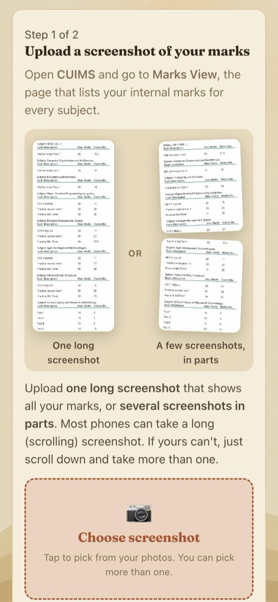
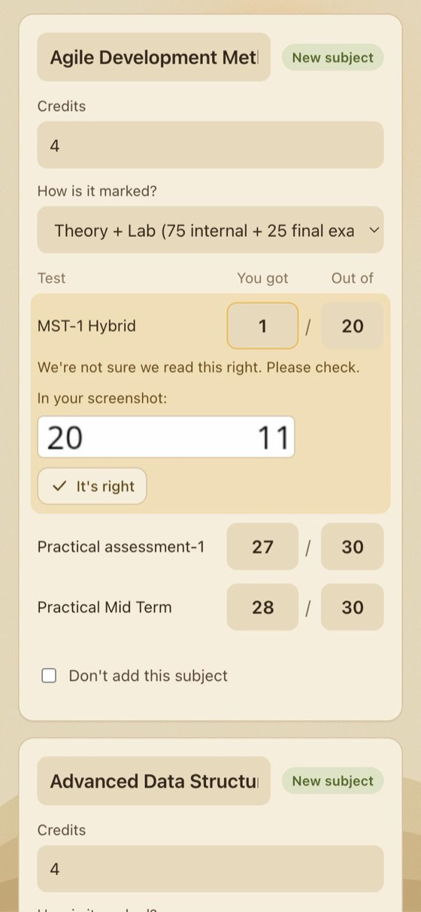
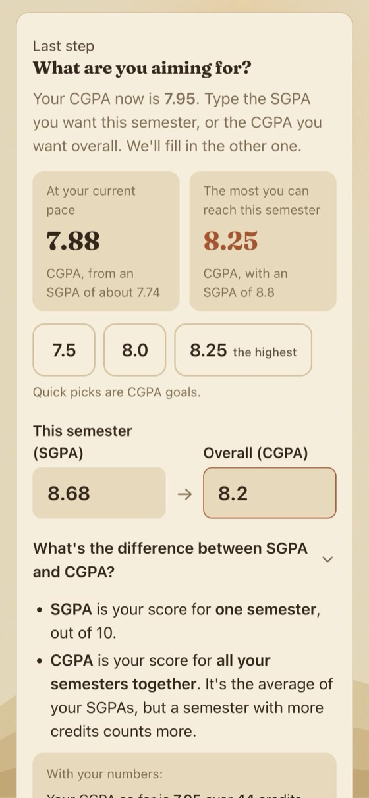
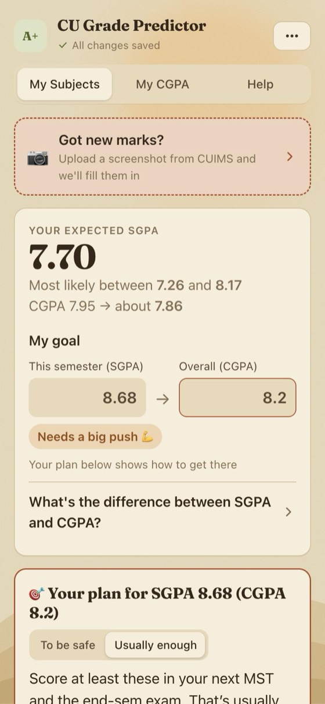
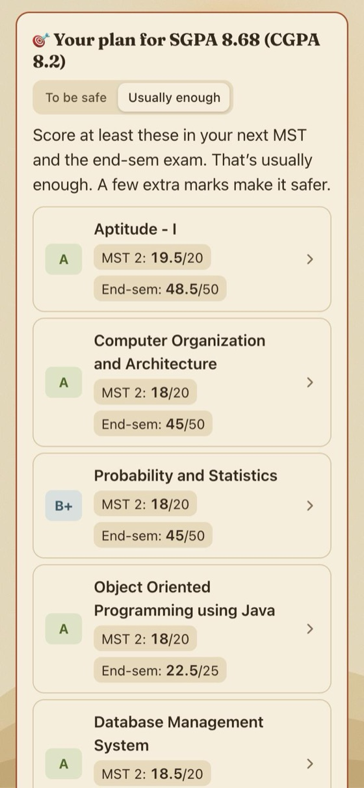
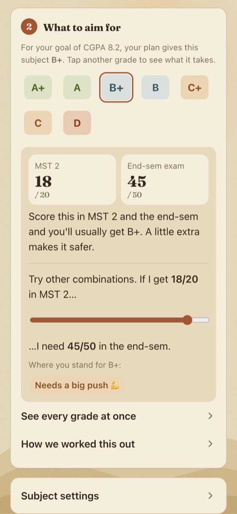

# CU Grade Predictor

Upload a screenshot of your CUIMS marks and get a plan: the marks to aim for in each MST and end-sem exam to reach the SGPA or CGPA you want.

Built for Chandigarh University students. Free, no sign-up, and your marks never leave your phone.

<table>
  <tr>
    <td align="center" width="33%"><br><b>1. Upload</b><br><sub>One long screenshot of Marks View, or a few in parts</sub></td>
    <td align="center" width="33%"><br><b>2. Check</b><br><sub>Shaky reads are highlighted next to that bit of your screenshot</sub></td>
    <td align="center" width="33%"><br><b>3. Set a goal</b><br><sub>Type an SGPA or a CGPA; the other fills itself in</sub></td>
  </tr>
  <tr>
    <td align="center"><br><b>4. See where you stand</b><br><sub>Expected SGPA, likely range, where your CGPA is heading</sub></td>
    <td align="center"><br><b>5. Get the plan</b><br><sub>A grade per subject, with MST and end-sem targets</sub></td>
    <td align="center"><br><b>6. Try trade-offs</b><br><sub>More in the MST means less needed in the end-sem</sub></td>
  </tr>
</table>

<sub>Screenshots in the Desert theme. Also available: Light, Space and Ocean.</sub>

## Features

- **Screenshot import.** Reads the CUIMS Marks View on your device. Overlapping screenshots merge without doubling marks, and doubtful numbers are flagged for you to check.
- **SGPA and CGPA goals.** Linked boxes, with a plain explanation of how CGPA is a credit-weighted average of SGPAs.
- **A plan for every subject.** The grade to aim for and the marks needed in each remaining MST and the end-sem. Choose "to be safe" or "usually enough".
- **Real grade cut-offs.** Calibrated on 54 real results. They predict 48 of them exactly, and the rest are one grade off near a boundary.
- **Private by design.** No account, no server. Marks are saved in your browser, and you can export a backup file.

## How grades are predicted

CU grades relatively, so each cut-off is an estimate with a range:

| Grade | A+ | A | B+ | B | C+ | C | D |
|---|---|---|---|---|---|---|---|
| Points | 10 | 9 | 8 | 7 | 6 | 5 | 4 |
| Usual total (out of 100) | 95.5 | 89.5 | 82.5 | 73.5 | 64 | 55 | 45 |

- **Total** = internal + external. The split depends on the subject: 75/25, 70/30, 60/40, 50/50, or 0/100.
- **Generous subjects get lower cut-offs.** Soft Skills, Communication Skills-I and General Proficiency mark more generously, so their cut-offs are lowered.
- **SGPA** = Σ(grade points × credits) ÷ Σ credits. **CGPA** is the same calculation across all semesters.

## Run it locally

```bash
npm install
npm run dev      # http://localhost:5173
npm test         # 48 tests, including real SGPAs reproduced from result sheets
npm run build    # static site in dist/
```

It deploys to Vercel as-is (Vite preset, no environment variables).

## Code map

| File | What it does |
|---|---|
| `src/lib/ocr.ts` | Reads screenshots with Tesseract.js, on the device |
| `src/lib/importer.ts` | Turns rows like `MST-1 Hybrid 20 15` into marks, and flags doubtful ones |
| `src/lib/grading.ts` | Grade points, cut-offs, and the real results they were calibrated on (`CALIBRATION`) |
| `src/lib/predict.ts` | Grade chances (simulation), the MST and end-sem planner, CGPA maths |
| `src/lib/factory.ts` | Subject lists, credits and splits (`KNOWN_SUBJECTS`, `TEMPLATES`) |
| `src/components/` | Screens: import, goal, dashboard, subject page, themes |

To improve the predictions, add rows to `CALIBRATION` in `grading.ts`. The tests show how many real grades the cut-offs reproduce.

## Help wanted

- **Result sheets** with internal and external marks, especially C to B grades and 3rd-semester subjects.
- **The internal marks scheme**: how much MSTs count within internals.
- **Subject codes and credits** for other semesters and branches.

---

<sub>An unofficial student tool, not affiliated with Chandigarh University. Predictions are estimates.</sub>
