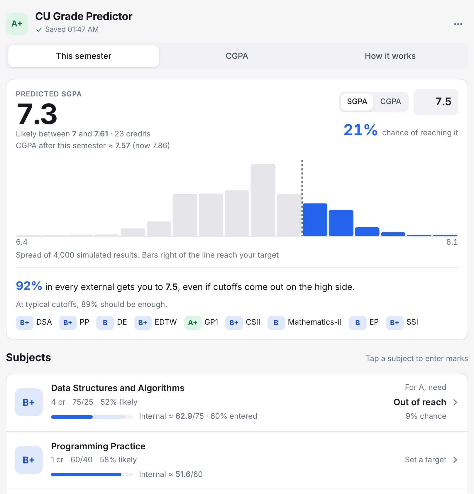
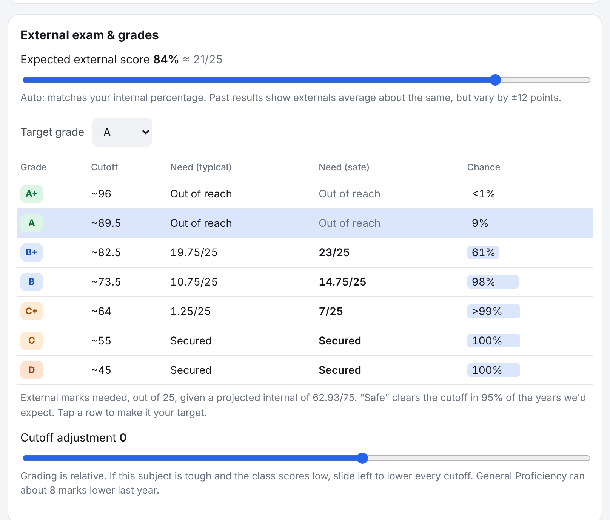

# CU Grade Predictor

Predict your Chandigarh University grades, SGPA and CGPA from the internal marks you have so far, and find out the minimum external score you need for the grade you want.



## Why

CU grades relatively: the cutoff for an A moves with how the class performs. A simple percentage calculator can't tell you what grade 78/100 will get. This app estimates the cutoffs from real result sheets and treats them as uncertain, so it gives you **probabilities** rather than a single guess.

## Features

- **Predicted SGPA** with a likely range and the chance of reaching your target SGPA or CGPA
- **Per-subject grade odds**, such as "B+ 52% likely"
- **Minimum external marks** for every grade, both at typical cutoffs and at a "safe" level that clears the cutoff 95% of the time
- **Internal-mark tracking** by assessment head (MSTs, assignments, worksheets, attendance), with projections for tests you haven't taken yet
- **CU course codes understood:** `xxH` is detected as 75/25, `xxP` as 60/40 and `xxT` as 50/50, plus templates for first-year CSE subject sets
- **CGPA planner** that uses your completed semesters
- **Private:** marks stay in your browser's `localStorage`, and you can export or import a JSON backup



*Screenshots use sample marks.*

## How it works

1. **Internal marks.** Each assessment head contributes its weight. Unfinished heads are projected at your running average.
2. **Grade cutoffs.** Each grade's cutoff on the total out of 100 is modelled as a normal distribution. The centre and spread of each one were fitted to real 2025-batch results (`src/lib/grading.ts`).
3. **Monte Carlo.** 4,000 simulated semesters draw your remaining internals, your external scores and the class cutoffs. The share of runs that land on each grade gives the odds, and the spread of the simulated SGPAs gives the range.

**Calibration check:** with the default cutoffs, the model reproduces **29 of 36** real graded results exactly (81%) and is never more than one grade off. It also reproduces the exact SGPA on all four sample result sheets. These checks run as unit tests.

## Run locally

```bash
npm install
npm run dev      # http://localhost:5173
npm test         # model tests against real result sheets
npm run build    # static site in dist/, deployable to Vercel, Netlify or GitHub Pages
```

Built with React 19, TypeScript and Vite. The prediction model has no other dependencies.

## Improving accuracy

To recalibrate the model:
1. Add rows from new result sheets to `CALIBRATION` in `src/lib/grading.ts`.
2. Adjust `BASE_CUTOFFS` there.
3. Run `npm test` to see how many real grades the new cutoffs reproduce.

## Disclaimer

This is an unofficial estimate and is not affiliated with Chandigarh University. Actual cutoffs vary by subject and by year.
